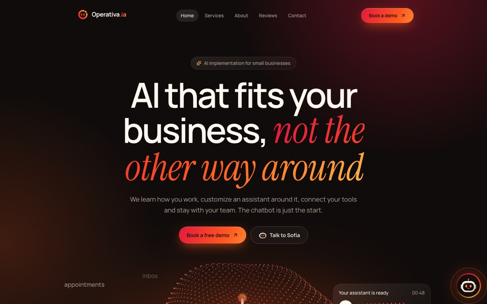
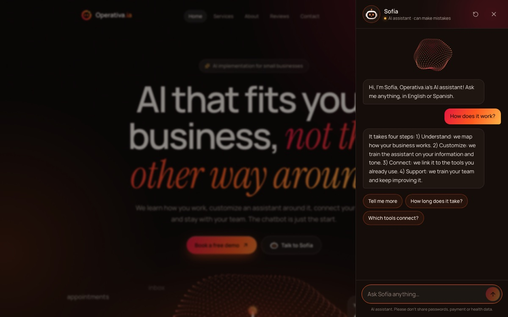
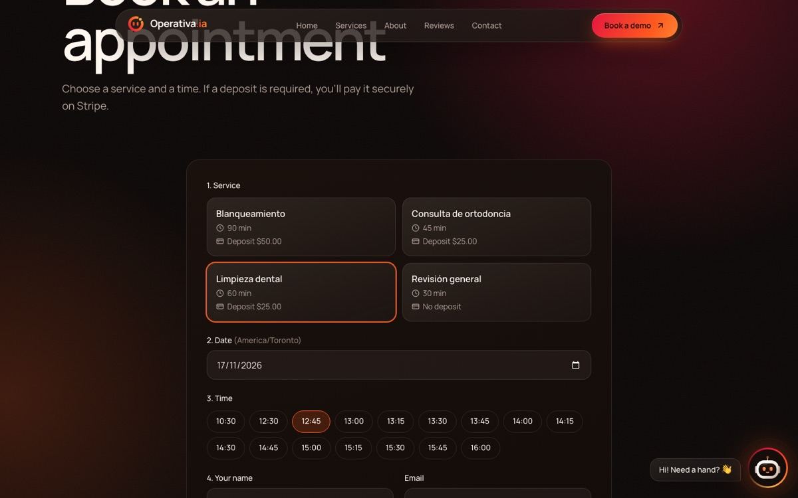
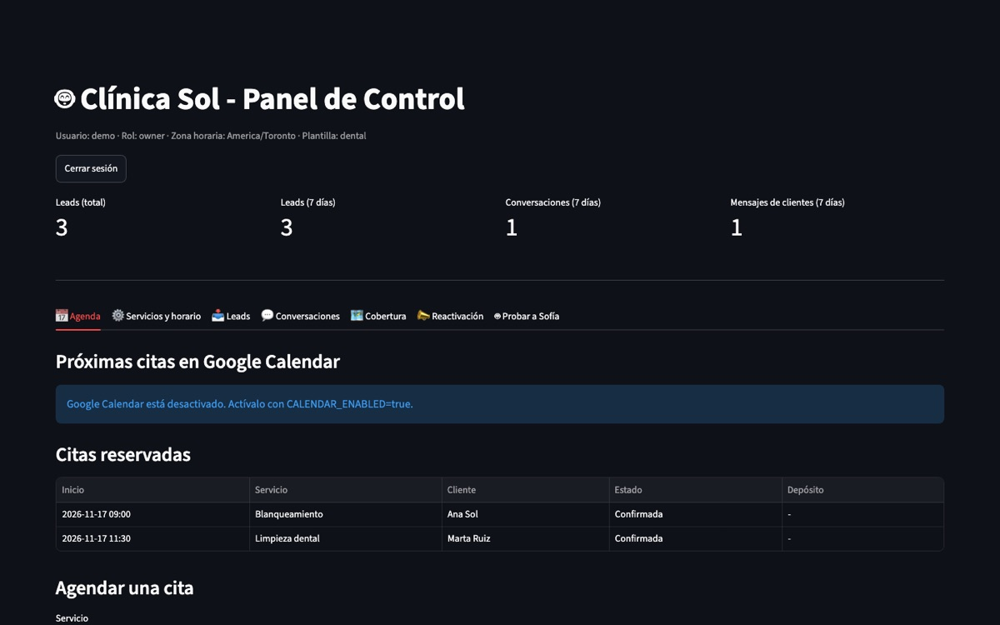

# Operativa.ia

**A multi-tenant operations platform for small service businesses: 24/7 lead capture, coverage checks, deposit-backed booking and customer reactivation, ready for a new business in 48 hours.**

Operativa.ia gives clinics, salons, physiotherapy practices and home-service businesses an AI assistant (**Sofía**) that answers customers on the website and on WhatsApp, checks whether the business covers their area or insurance, lets them book a slot and pay a deposit, and brings inactive customers back with consent-based email campaigns. Each business only ever sees its own data.

> 🚧 **Status: working prototype.** All features run end to end with tests, but real Stripe, WhatsApp, SMTP and Groq accounts have not been connected yet, and MFA plus a legal review are still required before onboarding real customers. See [SECURITY_REPORT.md](SECURITY_REPORT.md).



## Features

| Pillar | What it does |
| --- | --- |
| 💬 **24/7 lead capture** | Sofía answers on the website chat and on WhatsApp (Cloud API) using each business's own profile. Conversations are stored per business; contact requests require explicit consent. |
| 🗺️ **Coverage checks** | Each business sets its service area (postal prefixes, cities) and accepted insurers. Answers are deterministic: the AI extracts the data, the rules decide, and it can never claim coverage on its own. |
| 📅 **Booking with deposits** | Services with duration and a fixed deposit, weekly hours and live availability. Deposits are paid on Stripe Checkout; a signed webhook confirms the appointment and can sync it to Google Calendar. |
| 📣 **Customer reactivation** | Email campaigns to inactive customers, **only** with explicit opt-in (CASL), the business's address in every message and one-click unsubscribe. |
| ⚡ **48-hour onboarding** | Templates for dental clinics, beauty salons, physiotherapy and home services create a working business in one command, plus a [step-by-step onboarding guide](docs/onboarding-48h.md). |
| 🏢 **Multi-tenant by design** | Every table carries a `tenant_id`; the tenant always comes from the session or the public URL, never from the client. Roles per business: owner, admin and staff. |

<table>
  <tr>
    <td></td>
    <td></td>
  </tr>
  <tr>
    <td align="center"><sub>Sofía on the website</sub></td>
    <td align="center"><sub>Public booking page with deposits</sub></td>
  </tr>
</table>


<p align="center"><sub>Business dashboard (Streamlit). All data in the screenshots is fictitious.</sub></p>

## Security first

- **Fail-closed configuration:** the app refuses to start with wildcard CORS, `http://` origins in production, half-configured integrations or live Stripe keys outside production. Every integration stays off until fully configured.
- **Authentication:** Argon2id, progressive lockout, server-side sessions stored as hashes, `HttpOnly`/`Secure`/`SameSite=Strict` cookies and session-bound CSRF tokens.
- **Authorization:** role checks on every route, a test that fails if any unexpected route appears, and isolation tests between two businesses.
- **Webhooks:** HMAC signatures for WhatsApp (`X-Hub-Signature-256`) and Stripe (`Stripe-Signature` with a 5-minute tolerance), idempotency and replay protection.
- **Payments:** the amount always comes from the database, card data never touches the server, and double booking is prevented with an immediate transaction (tested with concurrent requests).
- **LLM safety:** user text only in the user role, whitelisted read-only tools with validated arguments, output filters for secrets, prompt leaks, prices and coverage claims, and token budgets per client, per business and globally.
- **Privacy:** no personal data in logs (pseudonymized identifiers), retention for conversations, no personal data in browser storage and a strict Content Security Policy.
- **CI:** pytest, Vitest, pip-audit, npm audit, Bandit, Semgrep and Gitleaks on every push, with actions pinned by SHA.

Details: [threat model](docs/SECURITY.md) · [security report](SECURITY_REPORT.md).

## Tech stack

| Layer | Technologies |
| --- | --- |
| Backend | Python 3.13, FastAPI, Pydantic, Uvicorn, SQLite, httpx |
| AI | Groq API (Llama 3.3) with tool calling |
| Website | React 18, TypeScript, Vite, Tailwind CSS, Motion |
| Dashboard | Streamlit |
| Integrations | WhatsApp Cloud API, Stripe Checkout, Google Calendar API, SMTP |
| Security & QA | Argon2, SlowAPI, pytest, Vitest, Bandit, Semgrep, pip-audit, Gitleaks |
| Deploy | Caddy (HTTPS reverse proxy), GitHub Actions |

## Project structure

```
backend/
  app/api/        Public, dashboard and webhook routes
  app/core/       Config (fail-closed), database, middleware, rate limits, logging
  app/services/   Tenants, auth, Sofía, coverage, booking, payments, WhatsApp, reactivation
  app/templates/  Vertical templates (JSON data only)
  tests/          480+ tests, including tenant isolation and abuse cases
frontend/
  src/            Public website, chat widget, booking and unsubscribe pages
  app.py          Streamlit dashboard for each business
deploy/           Caddyfile (serves the built site, never the dashboard)
docs/             Security model, onboarding guide, architecture, screenshots
```

## Run it locally

**Requirements:** Python 3.13 and Node 20+.

1. Copy `.env.example` to `.env`. Everything is optional for a local demo; add `GROQ_API_KEY` to get AI answers.
2. Backend and a demo business:
   ```bash
   cd backend
   python3.13 -m venv .venv && source .venv/bin/activate
   pip install -r requirements-dev.txt
   python -m app.cli create-tenant --slug operativa --name "Operativa.ia"      # used by the website
   python -m app.cli create-tenant --slug clinica-sol --name "Clínica Sol" --template dental \
       --location "100 Example Rd, Waterloo, ON"
   python -m app.cli create-user --tenant clinica-sol --username demo --role owner   # asks for a password
   uvicorn app.main:app --reload --port 8000
   ```
3. Dashboard (from the project root, with the virtual environment active):
   ```bash
   streamlit run frontend/app.py      # http://localhost:8501
   ```
4. Website:
   ```bash
   cd frontend
   npm ci
   npm run dev                        # http://localhost:5173 · booking: /#/book/clinica-sol
   ```

**Tests:** `python -m pytest -q` in `backend/` and `npm test` in `frontend/`.

Integrations (Stripe, WhatsApp, SMTP, Google Calendar) are configured through environment variables only; see `.env.example` and the [onboarding guide](docs/onboarding-48h.md).

## Roadmap

- MFA for owners and admins, and a legal review of the Terms and Privacy Policy (required before real customers)
- PostgreSQL with Row Level Security as a second isolation layer
- Persistent job queue for WhatsApp replies and emails
- Staging environment with live provider sandboxes and an OWASP ZAP scan

## Documentation

- [Onboarding in 48 hours](docs/onboarding-48h.md)
- [Security model](docs/SECURITY.md) and [security report](SECURITY_REPORT.md)
- [Architecture](docs/arquitectura.md)

## Author

Built by [Hsoja](https://github.com/Hsoja). Licensed under the [MIT License](LICENSE).
