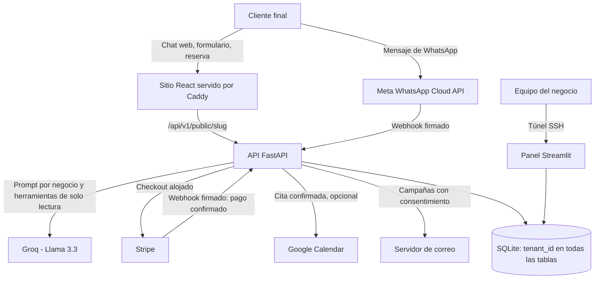

# 🏗️ Arquitectura - Operativa.ia

Flujo de datos y componentes de la plataforma tal como están implementados (rama `feat/producto-completo`, noviembre de 2026).

## 🔄 Flujo de datos

## 🧱 Componentes

| Componente | Dónde | Responsabilidad |
| --- | --- | --- |
| Sitio público | `frontend/src` | Chat con Sofía, contacto, reserva con depósito (`#/book/{slug}`) y baja de correos |
| API pública | `backend/app/api/public.py` | Chat, contacto, cobertura, servicios, horarios, reservas y baja, siempre por `slug` de negocio |
| API del panel | `backend/app/api/admin.py` | Rutas con sesión y rol; el negocio sale siempre de la sesión |
| Webhooks | `backend/app/api/webhooks.py` | WhatsApp y Stripe con verificación de firma e idempotencia |
| Sofía | `backend/app/services/agent.py` | Prompt por negocio, herramientas `check_coverage` y `list_available_slots`, filtros de salida |
| Panel | `frontend/app.py` | Agenda, servicios y horario, leads, conversaciones, cobertura, reactivación |
| Plantillas | `backend/app/templates/*.json` | Datos de arranque por vertical (solo datos, validados) |
| Proxy | `deploy/Caddyfile` | HTTPS, CSP y cabeceras; publica el sitio y la API, nunca el panel |

## 🔐 Límites de confianza

Navegador → Caddy → API → proveedores (Groq, Stripe, Meta, SMTP, Google). Todo lo que llega del navegador, del modelo o de un proveedor se valida en el servidor. Entre negocios hay un límite adicional: el `slug` público identifica al negocio, pero nunca da acceso a sus datos. Detalle en [SECURITY.md](SECURITY.md).
